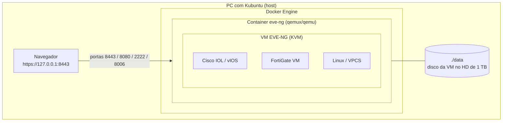

# Ambiente Docker + EVE-NG para labs de CCNA e NSE 4

Laboratório pessoal para estudar para o **Cisco CCNA (200-301)** e o **Fortinet NSE 4 (FortiOS Administrator)**, rodando o **EVE-NG dentro do Docker** em um PC com **Ubuntu** (Kubuntu, Desktop ou Server 26.04) e 1 TB de disco.

Tudo o que é preciso para montar o ambiente está aqui: scripts, `docker-compose`, passo a passo e roteiros de labs com configurações de referência.

---

## Como funciona

O EVE-NG **não existe como imagem Docker oficial**. Ele é um servidor completo (baseado em Ubuntu) que usa KVM para rodar cada roteador, switch e firewall dos labs. Para colocá-lo no Docker sem gambiarras, este projeto usa o container [`qemux/qemu`](https://github.com/qemus/qemu), que empacota o QEMU/KVM: o container inicializa a **ISO oficial do EVE-NG**, instala em um disco virtual salvo no seu HD e publica a interface web nas portas do seu PC.



Vantagens dessa abordagem:

- O Kubuntu continua intacto: nada do EVE-NG é instalado direto no sistema.
- Subir, desligar e mover o laboratório é um comando (`make up` / `make down`).
- O disco da VM fica em uma pasta só (`./data`), fácil de copiar como backup.

O ponto de atenção é que os nós dos labs viram **VMs dentro de uma VM**, então a **virtualização aninhada** precisa estar ativa no Kubuntu. O script `scripts/02-enable-nested-virt.sh` faz isso.

---

## Início rápido

```bash
git clone https://github.com/ResendeLucao/Ambiente-Docker-EVE-NG-.git
cd Ambiente-Docker-EVE-NG-

make check      # 1. confere CPU, KVM, RAM, disco e Docker
make docker     # 2. instala o Docker Engine (se ainda não tiver) -> faça logout/login
make nested     # 3. ativa a virtualização aninhada
make env        # 4. cria o .env -> ajuste EVE_RAM e EVE_CPUS
                # 5. baixe a ISO do EVE-NG e salve como iso/eve-ng.iso
make install    # 6. primeira inicialização, pela ISO
                #    abra http://127.0.0.1:8006 e siga o instalador
make up         # 7. dali em diante, sempre "make up" (sem ISO)
```

Depois da instalação, acesse **https://127.0.0.1:8443** com `admin` / `eve` e troque a senha.

Rode `make help` para ver todos os atalhos.

---

## Passo a passo detalhado

| # | Guia | O que você faz |
|---|------|----------------|
| 1 | [Requisitos](docs/01-requisitos.md) | Confere se o PC aguenta e escolhe a edição do EVE-NG |
| 2 | [Preparar o Ubuntu](docs/02-preparar-host.md) | BIOS, Docker Engine, virtualização aninhada e acesso remoto (Ubuntu Server) |
| 3 | [Instalar o EVE-NG no Docker](docs/03-instalar-eve-ng.md) | Baixa a ISO, sobe o container e roda o instalador |
| 4 | [Primeiro acesso](docs/04-primeiro-acesso.md) | Web, console HTML5, primeiro lab e acesso à internet |
| 5 | [Imagens Cisco e Fortinet](docs/05-imagens.md) | Onde conseguir imagens de forma legal e como enviar |
| 6 | [Operação e backup](docs/06-operacao-e-backup.md) | Ligar, desligar, atualizar e fazer backup |
| 7 | [Solução de problemas](docs/07-troubleshooting.md) | Erros comuns e como resolver |
| 8 | [Plano de estudos](docs/08-plano-de-estudos.md) | Roteiro até as duas certificações |

## Labs

| Trilha | Conteúdo |
|--------|----------|
| [CCNA](labs/ccna/README.md) | VLANs e trunks, STP, EtherChannel, roteamento entre VLANs, OSPF, DHCP/NAT/ACL, segurança de switch, IPv6 |
| [NSE 4](labs/nse4/README.md) | Configuração inicial, políticas e NAT, roteamento, autenticação, VPN IPsec, inspeção de segurança, HA |

---

## Estrutura do repositório

```
.
├── docker-compose.yml          # container do EVE-NG (uso normal)
├── docker-compose.install.yml  # acrescenta a ISO na instalação
├── .env.example                # RAM, CPU, disco, portas
├── Makefile                    # atalhos: make check, install, up...
├── scripts/
│   ├── 00-check-host.sh        # diagnóstico do PC
│   ├── 01-install-docker.sh    # Docker Engine no Kubuntu
│   ├── 02-enable-nested-virt.sh
│   ├── 03-start.sh             # sobe o container (install | normal)
│   ├── status.sh
│   ├── upload-qemu-image.sh    # FortiGate, Linux, vIOS...
│   ├── upload-iol-image.sh     # Cisco IOL
│   ├── create-linux-node.sh    # template Linux a partir de uma ISO
│   └── backup-labs.sh
├── docs/                       # passo a passo
├── labs/                       # roteiros e configs de referência
├── iso/                        # a ISO do EVE-NG fica aqui (ignorada pelo git)
└── images/                     # imagens dos fabricantes (ignoradas pelo git)
```

> **Importante:** imagens Cisco e Fortinet têm licença dos fabricantes. O `.gitignore` já impede que elas subam para o GitHub. Nunca publique essas imagens.
